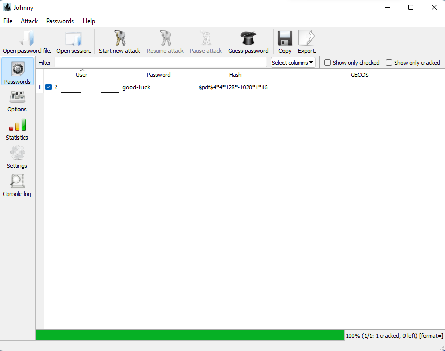

# 🔐 Password Cracking

**Exploring password-cracking techniques using John the Ripper (JTR) and network security tools, focusing on password hash identification.**

---

## 📌 Project Overview

This project involves the process of recovering a password from stored data or a protected file.

Security professionals use it to test how strong a password is and to show why weak passwords are risky. If a password is short or common, it can be found quickly, which proves the need for strong passwords.

The lab utilised four freely available tools: **John the Ripper (JTR), Johnny (JTR's graphical interface)**, and two tools developed by Networkwalks **Hash Calculator and Password Cracker** to demonstrate the process of recovering the password of a password-protected PDF file.

---

## 🎯 Objectives

The main objectives of this project are to:

- Understand the fundamentals of password cracking and password recovery techniques.
- Gain practical experience using John the Ripper (JTR) and Johnny for password-cracking operations.
- Understand how the Networkwalks Hash Calculator generates and identifies password hashes.
- Explore the Networkwalks Password Cracker tool for recovering passwords.
- Demonstrate how different security tools can be used to recover the password of a protected PDF file in a controlled lab environment.
- Understand the importance of strong passwords and effective security practices in preventing unauthorised access.
  
---

## 🏗️ Tools and Technologies Used

| ⚙️ Tool                          | 🧩 Purpose                                |
| --------------------------------- | ----------------------------------------  |
| John the Ripper (JTR)             | Password hash analysis and recovery       |
| Johnny                            | Graphical interface for John the Ripper   |
| Networkwalks Hash Calculator      | Hash generation and calculation           |
| Networkwalks Password Cracker     | Password recovery and cracking exercises  |
| Onlinehashcrack                   | Hash generation                           |

---

## 🪜 Lab Environment
- Target File: Password-protected PDF.
- Tools: JTR, Johnny, Hash Calculator, Password Cracker.
- Environment: Controlled laboratory environment.

---
#  Practical Implementation

## Step 1. Onlinehashcrack 
John the Ripper is an open-source password security auditing and recovery tool used to identify weak passwords through different cracking techniques.

Activities:
- Prepared and uploaded the password-protected PDF for analysis.
- Extracted the PDF password hash.
- saved the hash value in as a hash1.txt file.

---

## Step 2. John the Ripper (JTR) and Johnny (JTR GUI)

Johnny is a graphical user interface for John the Ripper that simplifies password-cracking operations.

Activities:
- Launched Johnny.
- imported the hash1.txt file to John the Ripper.
- Configured and executed the password recovery process.
- Examined the results.

---

## Step 3. Networkwalks Hash Calculator

Hash Calculator is a Networkwalks tool used to generate or calculate hash values for security analysis and password-related exercises.

Activities:
- Accessed the Hash Calculator.
- Uploaded the password-protected PDF for analysis.
- Generated the corresponding hash value.
- Examined and copied the output.

---

## Step 4. Networkwalks Password Cracker

Password Cracker is a Networkwalks tool used to demonstrate password recovery techniques.

Activities:
- Pasted the generated hash value.
- Executed the password recovery process.
- Analysed the results.
- Verified the recovered password against the test PDF.

---

##  Results and Findings

The lab provided practical exposure to password recovery using different security tools. It demonstrated how password-protected PDF documents can be assessed and how different tools approach password recovery.

Key findings:
- Password hashes can be analysed using specialised security tools.
- Different tools provide different approaches to password recovery.
- Weak passwords are generally more susceptible to dictionary-based attacks.
- Strong password practices help reduce the risk of unauthorised access.

---

# 💡 What I Learned

Through this hands-on lab, I gained practical knowledge of password hashing, password recovery, and the use of security tools. 

Key takeaways include:
- Understanding how password hashes work and their role in password security.
- Learning how to use John the Ripper (JTR) and Johnny for password recovery.
- Gaining practical experience generating hash values using Networkwalks Hash Calculator.
- Understanding how Networkwalks Password Cracker can be used for password recovery.
- Learning how dictionary-based attacks can expose weak or predictable passwords.
- Understanding the importance of strong passwords, secure encryption, and proper password management.
- Developing practical troubleshooting and problem-solving skills while working with password security tools.
- 
---

# 🔐 Security Recommendation
- Use long and complex passwords.
- Avoid predictable and commonly used passwords.
- Use secure password hashing algorithms.
- Apply appropriate encryption to sensitive documents.
- Protect password-protected files and securely manage their passwords

---

# Conclusion
This practical exercise strengthened my understanding of password security, hash analysis, and password recovery techniques. Working with John the Ripper, Johnny, and Networkwalks tools provided hands-on experience with security assessment tools and highlighted the importance of strong authentication practices.

# 👤 Author

**Oguntade Samuel**\
Cybersecurity Intern B084

LinkedIn: [https://www.linkedin.com/in/samuel-oguntade-604985438/](https://www.linkedin.com/in/samuel-oguntade-604985438/)

---

## 📌 Project Information

**Program Name:** Cybersecurity at Networkwalks | **Week:** 01 | **Project:** Cybersecurity & Pentesting Lab Setup | **Repository:** GitHub
